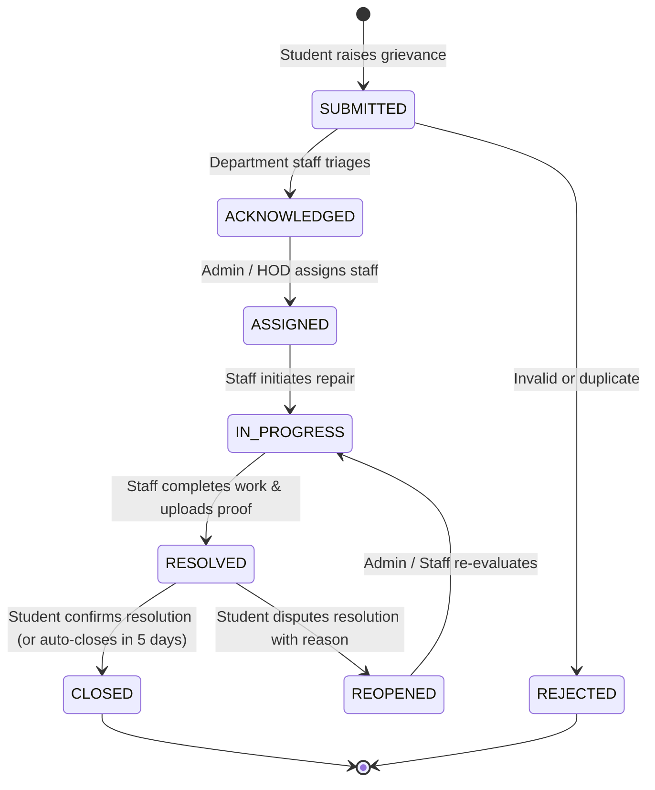

# Grievio - Product Master Plan & Engineering Specification

> **Tagline:** Every concern deserves a resolution.  
> **Document Version:** 1.0.0 (Phase 1 Initial Release)  
> **Target Audience:** Engineering, Product, DevOps, Campus Administration Stakeholders

---

## 1. Executive Summary & Vision

**Grievio** is an enterprise-grade, multi-institution Campus Grievance and Maintenance Management Platform. Modern colleges, universities, and polytechnic institutes often struggle with scattered, unverified, and opaque grievance mechanisms—relying on physical drop boxes, fragmented WhatsApp groups, or generic email inboxes. These methods lack accountability, auditability, SLA tracking, privacy guarantees, and institutional business intelligence.

Grievio establishes a single digital source of truth for:
- **Facility Maintenance**: Classrooms, laboratories, hostels, libraries, dining halls, and grounds.
- **Academic & Departmental Concerns**: Timetables, equipment malfunctions, lab resources.
- **Administrative & Campus Life**: Transport, sanitation, security, and student welfare.

The product architecture guarantees strict multi-tenant isolation, enterprise role-based access control (RBAC), end-to-end auditability, and omni-channel access across Web and Mobile (Android & iOS).

---

## 2. User Roles & Access Matrix

| Role | Scope | Key Capabilities |
| :--- | :--- | :--- |
| **Student** | Personal & Institution | • Authenticate via institution code & verified credentials.<br>• Raise grievances with category, department, location, urgency, and photos/docs.<br>• Track real-time progress via timeline and stage updates.<br>• Communicate via bidirectional comment threads.<br>• Confirm resolution or request reopening with reasoning within grace period. |
| **Department Staff** | Department & Assigned Issues | • Triage and claim complaints assigned to their department.<br>• Inspect attachments, location specifics, and priority tags.<br>• Update status (Acknowledged, In Progress, On Hold, Resolved).<br>• Add internal staff notes and public student-facing resolution notes.<br>• Upload photo proof of completed maintenance/resolution. |
| **College Administrator** | Institution-wide | • Manage campus departments, categories, locations (blocks, floors, rooms).<br>• Approve or review student and staff registrations.<br>• Reassign complaints across departments; set SLA thresholds.<br>• Intervene in escalated or overdue grievances.<br>• Access operational analytics, department turnaround time, and satisfaction metrics. |
| **Platform Super Admin** | Global / Multi-Tenant | • Provision and onboard colleges and universities.<br>• Configure tenant domain mappings, storage quotas, and feature flags.<br>• Monitor platform health, aggregate system load, and audit logs. |

---

## 3. High-Level System Architecture

Grievio adheres to a modern, decoupled client-server architecture:

```
                  ┌────────────────────────────────────────┐
                  │           Client Applications          │
                  │  ┌──────────────────┐ ┌─────────────┐  │
                  │  │ React Web App    │ │ Expo Mobile │  │
                  │  │ (Vite + Tailwind)│ │ (iOS/Android)│ │
                  │  └─────────┬────────┘ └──────┬──────┘  │
                  └────────────┼─────────────────┼─────────┘
                               │ HTTPS / REST    │
                               ▼                 ▼
                  ┌────────────────────────────────────────┐
                  │        API Gateway / Reverse Proxy     │
                  │         (Nginx / Traefik / SSL)        │
                  └────────────────────┬───────────────────┘
                                       │
                                       ▼
                  ┌────────────────────────────────────────┐
                  │      Django REST Framework Core        │
                  │  ┌───────────┐ ┌────────────────────┐  │
                  │  │  JWT Auth │ │ Multi-Tenant Guard │  │
                  │  └─────┬─────┘ └──────────┬─────────┘  │
                  │        │                  │            │
                  │  ┌─────▼──────────────────▼─────────┐  │
                  │  │         Modular Apps             │  │
                  │  │ accounts   • institutions        │  │
                  │  │ departments • complaints         │  │
                  │  │ notifications • reporting        │  │
                  │  └────────────────┬─────────────────┘  │
                  └───────────────────┼────────────────────┘
                                      │
                   ┌──────────────────┴──────────────────┐
                   ▼                                     ▼
      ┌───────────────────────────┐         ┌─────────────────────────┐
      │   PostgreSQL Database     │         │   Object Storage (S3)   │
      │   • Relational Integrity  │         │   • Grievance Photos    │
      │   • Row-Level Isolation   │         │   • Proof of Resolution │
      │   • Audit Logging         │         │   • Identity Badges     │
      └───────────────────────────┘         └─────────────────────────┘
```

---

## 4. Multi-Tenant Data Isolation Strategy

1. **Discriminator Column Multi-Tenancy**:
   - Every core entity (`Department`, `Complaint`, `Notification`, `UserProfile`, `Location`) maintains a foreign key to `Institution`.
   - Django QuerySets enforce automatic filtering using a custom `TenantManager` and `TenantModel` base class:
     ```python
     class TenantModel(models.Model):
         institution = models.ForeignKey('institutions.Institution', on_delete=models.CASCADE)
         class Meta:
             abstract = True
     ```
2. **Server-Side Authorization Layer**:
   - `IsInstitutionMember`: Ensures the requesting user belongs to the institution target.
   - `IsComplaintOwnerOrStaff`: Restricts students strictly to their own grievances; staff to their assigned department's grievances; admins to institutional grievances.
3. **No Cross-Tenant Leaks**:
   - Institution IDs are never trusted solely from request payloads. They are verified against the authenticated user's JWT claims.

---

## 5. Database Schema & Domain Modeling

### 5.1 Accounts App
- **User**: Custom user extending `AbstractUser`. Email-based or username-based login, phone number, role (`STUDENT`, `STAFF`, `ADMIN`, `SUPERADMIN`), institution foreign key (nullable for superadmins), avatar, verification status (`is_verified`).
- **StudentProfile**: Roll number, course/branch, graduation year, hostel/day scholar flag.
- **StaffProfile**: Staff ID, designation, assigned department.

### 5.2 Institutions App
- **Institution**: Unique slug, official code (`COLLEGE_CODE`), full name, address, contact email, logo, active status, domain restrictions (e.g., `@college.edu`).
- **CampusLocation**: Building/Block, Floor, Room/Lab designation, GPS coordinates (optional).

### 5.3 Departments & Categories App
- **Department**: Name (e.g., "Electrical & Maintenance", "IT Services", "Hostel Admin", "Academic Affairs"), head of department email, SLA target hours.
- **ComplaintCategory**: Linked to department, category name (e.g., "Water Leakage", "Network Outage", "Broken Furniture"), default urgency (`LOW`, `MEDIUM`, `HIGH`, `CRITICAL`).

### 5.4 Complaints App
- **Complaint**:
  - `ticket_number`: Human-readable identifier (e.g., `MIT-2026-0042`).
  - `institution`, `student`, `department`, `category`, `location`.
  - `title`, `description`, `priority` (`LOW`, `MEDIUM`, `HIGH`, `CRITICAL`).
  - `status`: `SUBMITTED` ➔ `ACKNOWLEDGED` ➔ `ASSIGNED` ➔ `IN_PROGRESS` ➔ `RESOLVED` ➔ `CLOSED` (or `REOPENED`).
  - `assigned_staff`: Nullable ForeignKey to User.
  - `resolution_notes`: Detailed explanation of fix.
  - `resolved_at`, `closed_at`, `reopened_at`.
- **ComplaintAttachment**: Complaint FK, uploaded file/image, file type, uploaded_by FK.
- **ComplaintTimeline / History**: Event type (Status Change, Reassignment, Note Added), actor, old value, new value, timestamp.
- **ComplaintComment**: Public student-staff communication thread or internal staff notes.

### 5.5 Notifications App
- **Notification**: Recipient FK, title, body, notification type, reference entity (Complaint ID), is_read flag, timestamp.

### 5.6 Reporting & Analytics App
- **SLA Metrics**: Resolution turnaround time, overdue counter, category frequency, satisfaction ratings.

---

## 6. Complaint Lifecycle State Machine



---

## 7. Security & Compliance Architecture

1. **Authentication & Token Flow**:
   - JSON Web Tokens (JWT) using `djangorestframework-simplejwt`.
   - Access Token lifespan: 15 minutes.
   - Refresh Token lifespan: 7 days with automatic token rotation.
   - Blacklist support on logout.
2. **Authorization & RBAC**:
   - Custom DRF permission classes: `IsStudent`, `IsStaffMember`, `IsInstitutionAdmin`, `IsSuperAdmin`.
   - Object-level permissions verifying ownership and tenancy.
3. **Data Security**:
   - Sensitive credentials stored strictly in `.env`.
   - Passwords hashed using Argon2 or PBKDF2 with high iterations.
   - CORS strictly restricted to authorized web/mobile origins.
   - SQL injection prevention via Django ORM parameterized queries.
   - File upload validation (type, size limits, antivirus-safe naming).

---

## 8. Implementation Roadmap

### Phase 1: Foundation & Scaffold (Current Phase)
- [x] Comprehensive architectural planning & documentation (`PROJECT_PLAN.md`, `README.md`).
- [x] Django backend setup with modular structure (`accounts`, `institutions`, `departments`, `complaints`, `notifications`, `reporting`).
- [x] PostgreSQL & environment variable configuration with resilient fallback.
- [x] Django REST Framework, SimpleJWT, and CORS integration.
- [x] React.js + Vite + Tailwind CSS web app with modern SaaS landing page and Axios API layer.
- [x] React Native + Expo mobile application setup with welcome screens and API client.
- [x] Verification, health endpoints, and build readiness.

### Phase 2: Core Authentication & Multi-Tenancy (Next)
- [ ] Institution registry and student/staff registration with college code validation.
- [ ] JWT authentication endpoints (login, refresh, profile, logout).
- [ ] Role-based route guards in Web and Mobile.

### Phase 3: Grievance Lifecycle & Media Handling
- [ ] Multi-step grievance submission form (category, department, location, images).
- [ ] Staff triage, assignment, status transition engine, and resolution proof uploads.
- [ ] Bidirectional comment threads and timeline audit logs.

### Phase 4: Notifications, Realtime Updates & SLA Escalation
- [ ] In-app notification bell and email alert triggers.
- [ ] Background celery / cron jobs for SLA tracking and overdue warnings.
- [ ] Reopening workflows and student feedback rating.

### Phase 5: Institution Analytics & Production Hardening
- [ ] College admin dashboard (resolution rates, department performance, category breakdown).
- [ ] Production Dockerfiles, Nginx configs, and cloud deployment guides.

---

## 9. Technology Stack Matrix

| Tier | Component | Technology | Rationale |
| :--- | :--- | :--- | :--- |
| **Backend** | Runtime & Framework | Python 3.12+ / Django 5+ | Mature, secure ORM, robust ecosystem. |
| **Backend** | API Engine | Django REST Framework | Industry-standard serializer & viewset engine. |
| **Backend** | Authentication | Simple JWT | Stateless, secure, scalable tokens for web & mobile. |
| **Database** | Primary RDBMS | PostgreSQL 16+ | ACID compliance, JSONB support, relational integrity. |
| **Web** | Framework & Bundler | React 18+ / Vite | Blazing fast HMR, small bundle size, pure JavaScript. |
| **Web** | Styling | Tailwind CSS | Utility-first, clean design system, light-theme palette. |
| **Web** | Navigation | React Router v6 | Declarative client-side routing. |
| **Mobile** | Framework | React Native / Expo | Cross-platform parity (iOS & Android) with single codebase. |
| **Mobile** | Navigation | Expo Router | Modern file-based routing native architecture. |
| **Network** | HTTP Client | Axios | Unified interceptors, token injection, and error handling. |
