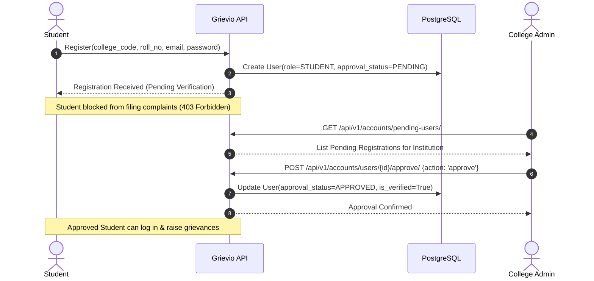
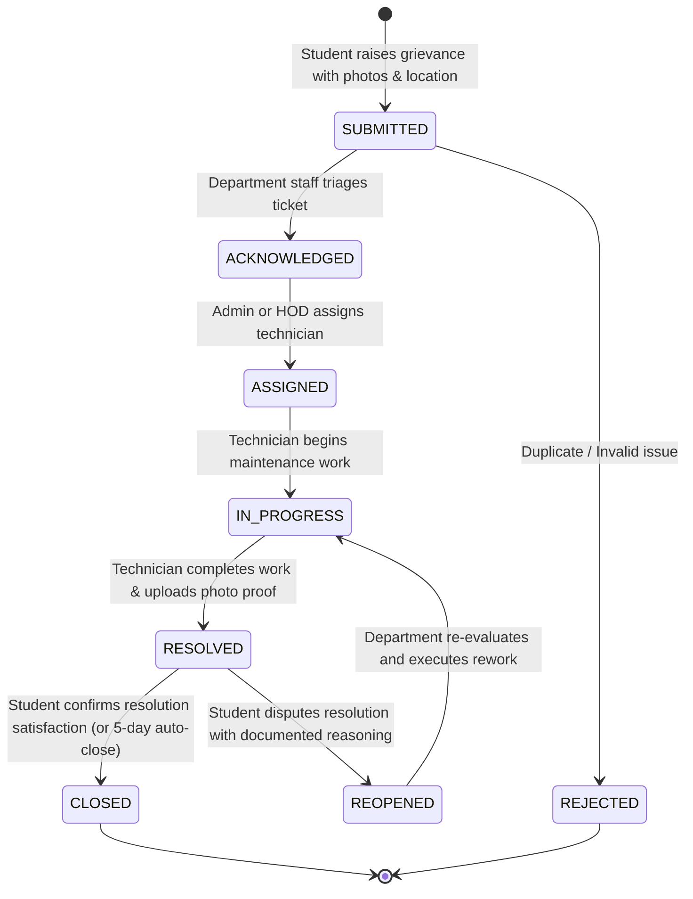

# Grievio - Product Master Plan & Engineering Specification

> **Product Name:** Grievio  
> **Tagline:** Every concern deserves a resolution.  
> **Document Version:** 1.1.0 (Architecture Baseline & Multi-Institution Governance)  
> **Document Status:** Finalized Core Architecture Specification  
> **Target Audience:** Engineering, Product, DevOps, Campus Administration Stakeholders

---

## 1. Executive Summary & Vision

**Grievio** is a multi-institution Campus Grievance and Maintenance Management Platform engineered for real-world deployment in universities, colleges, and polytechnic institutes. Modern educational institutions frequently struggle with opaque, disorganized, and unaccountable complaint mechanisms—such as paper logbooks, informal messaging groups, or unmonitored inboxes. These methods lack auditability, SLA tracking, role-based workflows, privacy guarantees, and institutional business intelligence.

Grievio establishes a unified digital platform for:
- **Campus Facility Maintenance**: Classrooms, laboratories, hostels, libraries, dining halls, sports grounds, and washrooms.
- **Academic & Departmental Concerns**: Timetable clashes, equipment malfunctions, lab resources, and departmental requests.
- **Administrative & Campus Life**: Transportation, sanitation, electrical grids, security, and student welfare.

Grievio is designed from day one as a true multi-tenant SaaS platform that operates seamlessly across **Responsive Web** and **Cross-Platform Mobile (Android & iOS)**.

---

## 2. Mandatory Core Architectural Pillars

These requirements represent non-negotiable architectural constraints enforced across the database schema, business logic, API permissions, and client applications.

### 2.1 Multi-Institution Centralized Platform
Grievio hosts multiple educational institutions on a single centralized system while guaranteeing strict logical data boundaries:
- **Unique College Identity**: Every college is registered with a unique institution ID, slug, and official college code (e.g., `MIT-ENG`, `STANFORD`, `IIT-DEL`).
- **Independent Tenant Subsystems**:
  - Each college has its own student body and department staff.
  - Each college maintains its own departments (e.g., Electrical, IT Services, Hostel Admin, Sanitation) and custom complaint categories.
  - Each college maintains its own campus locations (blocks, floors, rooms/labs).
  - Each college maintains its own complaints, assignments, resolution notes, and audit history.
  - Each college is governed by its own College Administrator.
  - Each college has its own real-time operational dashboard, turnaround statistics, and SLA reports.
- **Zero Cross-Tenant Leakage**: Data belonging to one institution is never visible, queryable, or mutable by users of another institution.

### 2.2 Student Registration and Approval Workflow
To prevent unauthorized individuals or students from other institutions from accessing campus systems:
1. **Registration**: Students register using their institution's unique college code and college credentials (official roll number, name, and email).
2. **Pending Approval State**: All new student registrations default strictly to `PENDING` approval status (`approval_status = 'PENDING'`).
3. **Administrator Review**: The respective College Administrator reviews incoming registrations in an administrative approval queue to verify the applicant against campus records, with the ability to **Approve** or **Reject** (with a documented rejection reason).
4. **Access Enforcement**: Users in `PENDING` or `REJECTED` status are blocked by server-side permission guards (`IsApprovedUser`) from accessing protected application features (such as raising complaints, viewing tickets, commenting, or accessing departmental data).
5. **Approved Access**: Once approved (`approval_status = 'APPROVED'`), students gain full access to the web and mobile platforms.



### 2.3 Department Staff Governance
- **Administrative Provisioning**: Staff accounts must be created or authorized directly by the College Administrator.
- **Institutional & Departmental Binding**: Every staff member belongs to exactly one institution and is assigned to a specific department (e.g., Electrical, Plumbing, IT).
- **Scoped Complaint Access**: Staff can access grievances that are:
  1. Assigned to their specific department (`complaint.department == staff.department`), OR
  2. Directly assigned to them as the designated technician (`complaint.assigned_staff == staff.user`).
- **No Cross-Institution Access**: Staff can never query or view complaints outside their own institution.

### 2.4 Mobile Application Dual-Role Support
The native mobile application (built with React Native and Expo Router) is optimized for on-the-go campus interactions and specifically supports **two key roles**:
1. **Students**:
   - Register using college code and credentials.
   - File grievances with category, department, location tagging, and photo evidence.
   - Track ticket progress in real-time through timeline milestones.
   - Add comments and communicate directly with assigned technicians.
   - Receive push and in-app notifications on status changes.
   - Confirm resolution satisfaction or submit dispute for reopening.
2. **Department Staff & Technicians**:
   - View prioritized inboxes of assigned departmental complaints.
   - Inspect issue descriptions, campus location tags, and student evidence photos on-site.
   - Update complaint status (*Acknowledged ➔ In Progress ➔ Resolved*).
   - Add internal department notes and public resolution summaries.
   - Capture and upload photographic proof of completed repairs directly from device cameras.

### 2.5 Web Application Quad-Role Support
The responsive web application (React + Vite + Tailwind CSS) supports **all four platform roles**:
1. **Student Portal**: Full grievance registration, photo proof, tracking, and comment threads.
2. **Department Staff Portal**: Department queues, work order management, status updates, and proof submission.
3. **College Administrator Console**:
   - College profile and campus location management (blocks, floors, rooms).
   - Department and complaint category configuration with SLA thresholds.
   - Student and staff registration approval/rejection queue.
   - Staff account creation and department assignment.
   - Cross-department ticket reassignment and escalation intervention.
   - Institution-wide turnaround analytics and exportable compliance reports.
4. **Platform Super Administrator Gateway**:
   - Central onboarding and approval of new educational institutions.
   - Management and assignment of College Administrators.
   - Tenant lifecycle controls (activate, suspend, deactivate institutions).
   - Platform-wide system telemetry, audit logs, and load monitoring.

### 2.6 Platform Super Administrator vs College Administrator Separation
Grievio maintains a strict separation of administrative privileges:
- **Platform Super Administrator**:
  - Operates at the Grievio global platform layer.
  - Provisions and approves new colleges.
  - Manages subscription status and institution status (`PENDING`, `ACTIVE`, `SUSPENDED`, `DEACTIVATED`).
  - Oversees institution administrators.
  - Does NOT handle daily campus complaints or student grievances.
- **College Administrator**:
  - Operates strictly within their own institution boundary.
  - Manages internal college departments, categories, staff, and students.
  - Cannot access other colleges or modify platform-level settings.

### 2.7 Security & Database Architecture
1. **Relational Tenant Invariant**: Every institution-owned entity (`Department`, `CampusLocation`, `ComplaintCategory`, `Complaint`, `ComplaintAttachment`, `ComplaintComment`, `Notification`) has a foreign key to `Institution`.
2. **Backend-Derived Tenancy**: The backend API determines tenant scope exclusively from `request.user.institution`.
3. **No Trust of Client-Supplied Institution IDs**: Frontend requests cannot inject or override `institution_id`. All create operations explicitly assign `request.user.institution`.
4. **Server-Side Role-Based Permissions**: Custom permission classes (`IsApprovedUser`, `IsStudent`, `IsDepartmentStaff`, `IsCollegeAdmin`, `IsPlatformSuperAdmin`) enforce authorization before executing view logic.
5. **Student Complaint Ownership**: Students are strictly prevented from querying or viewing grievances raised by other students (`filter(student=request.user)`).
6. **Isolated Queries**: All ORM queries, aggregations, and counts filter automatically by the authenticated institution.

---

## 3. High-Level System Architecture

```
                  ┌────────────────────────────────────────────────────────┐
                  │                  Client Applications                   │
                  │  ┌────────────────────────┐ ┌───────────────────────┐  │
                  │  │     React Web App      │ │   Expo Mobile App     │  │
                  │  │    (Vite + Tailwind)   │ │  (React Native / iOS  │  │
                  │  │   • Student            │ │    & Android)         │  │
                  │  │   • Department Staff   │ │  • Student            │  │
                  │  │   • College Admin      │ │  • Department Staff   │  │
                  │  │   • Platform Superadmin│ │                       │  │
                  │  └───────────┬────────────┘ └───────────┬───────────┘  │
                  └──────────────┼──────────────────────────┼──────────────┘
                                 │ HTTPS / REST (Bearer JWT)│
                                 ▼                          ▼
                  ┌────────────────────────────────────────────────────────┐
                  │              API Gateway & Reverse Proxy               │
                  │                (Nginx / Traefik / SSL)                 │
                  └───────────────────────────┬────────────────────────────┘
                                              │
                                              ▼
                  ┌────────────────────────────────────────────────────────┐
                  │               Django REST Framework Core               │
                  │  ┌────────────────────┐   ┌─────────────────────────┐  │
                  │  │  Simple JWT Auth   │   │  Tenant Security Guard  │  │
                  │  │ (Access & Refresh) │   │  (request.user.inst)    │  │
                  │  └─────────┬──────────┘   └────────────┬────────────┘  │
                  │            │                           │               │
                  │  ┌─────────▼───────────────────────────▼────────────┐  │
                  │  │                     Modular Apps                 │  │
                  │  │  • accounts      (RBAC, Users, Approval Queue)   │  │
                  │  │  • institutions  (Tenants, Campuses, Locations)  │  │
                  │  │  • departments   (Depts, Categories, SLAs)       │  │
                  │  │  • complaints    (Lifecycle, Proof, Comments)    │  │
                  │  │  • notifications (In-App & Push Alerts)          │  │
                  │  │  • reporting     (Metrics, Turnaround Analytics) │  │
                  │  └────────────────────────┬─────────────────────────┘  │
                  └───────────────────────────┼────────────────────────────┘
                                              │
                         ┌────────────────────┴────────────────────┐
                         ▼                                         ▼
            ┌───────────────────────────┐             ┌─────────────────────────┐
            │   PostgreSQL Database     │             │   Object Storage (S3)   │
            │   • Relational Integrity  │             │   • Evidence Photos     │
            │   • Row-Level Isolation   │             │   • Resolution Proof    │
            │   • Audit Trail Logs      │             │   • Avatars & Badges    │
            └───────────────────────────┘             └─────────────────────────┘
```

---

## 4. Role & Capability Matrix

| Capability | Student | Department Staff | College Admin | Platform Super Admin |
| :--- | :---: | :---: | :---: | :---: |
| **Platform Access Medium** | Web & Mobile | Web & Mobile | Web | Web |
| **Register with College Code** | Yes (Defaults to Pending) | Via Admin / Pending | Super Admin Provisioned | Initial System Seed |
| **Requires Admin Approval** | **Yes** (Strict Guard) | **Yes** | No | No |
| **Submit Grievance with Photos** | **Yes** | No | No | No |
| **View Own Grievances** | **Yes** (Only Own) | No | All (Own College) | All (Global) |
| **View Assigned Dept Grievances** | No | **Yes** | All (Own College) | All (Global) |
| **Update Status & Resolution Proof** | No | **Yes** | **Yes** | Yes |
| **Confirm Resolution / Reopen** | **Yes** | No | Override Option | No |
| **Manage College Departments & SLAs** | No | No | **Yes** | View / Override |
| **Approve / Reject Student Registrations**| No | No | **Yes** | Global View |
| **Create & Assign Staff Accounts** | No | No | **Yes** | No |
| **Onboard / Suspend Institutions** | No | No | No | **Yes** |

---

## 5. Complaint Lifecycle State Machine



---

## 6. Implementation Roadmap

### Phase 1: Foundation, Multi-Tenant Architecture & Scaffolding (Current Status: Complete)
- [x] Master engineering specification & requirements document (`PROJECT_PLAN.md`).
- [x] Project handbook and local setup guide (`README.md`).
- [x] Django backend initialized with 6 modular applications (`accounts`, `institutions`, `departments`, `complaints`, `notifications`, `reporting`).
- [x] Database configuration supporting PostgreSQL with resilient SQLite fallback.
- [x] Custom User model with 4 distinct roles and 3-state `ApprovalStatus` (`PENDING`, `APPROVED`, `REJECTED`).
- [x] Server-side permissions (`IsApprovedUser`, `IsStudent`, `IsDepartmentStaff`, `IsCollegeAdmin`, `IsPlatformSuperAdmin`).
- [x] Admin approval endpoints (`/api/v1/accounts/pending-users/`, `/api/v1/accounts/users/<id>/approve/`).
- [x] React web client with Vite, Tailwind CSS, Lucide React, and interactive landing page.
- [x] Expo mobile client with Expo Router, welcome screens, and cross-platform API service.
- [x] Automated test suite verifying health, JWT authentication, registration approval, and strict multi-tenant isolation (6/6 tests passing).

### Phase 2: Authentication & Approval System Implementation
- [ ] JWT authentication flows in Web and Mobile (login, token refresh, auto-retry on 401).
- [ ] Student registration UI with college code lookup and instant validation.
- [ ] College Admin registration review console (one-click approval/rejection with reason).
- [ ] Role-based route guards in React Web and Expo Router.

### Phase 3: Grievance Lifecycle Engine & Evidence Uploads
- [ ] Multi-step grievance filing form (department selection, category, campus location picker, camera/gallery upload).
- [ ] Department technician workbench (inbox, status transition controls, resolution proof upload).
- [ ] Real-time timeline audit trail and bidirectional public/internal comment threads.

### Phase 4: Notifications, Reopening Workflows & SLA Escalation
- [ ] Push notifications for mobile (Expo Notifications) and in-app alert center.
- [ ] Student resolution confirmation and reopening dispute workflow.
- [ ] Automated background tasks (Celery/Cron) to track SLA breaches and trigger admin escalation alerts.

### Phase 5: Institutional Analytics, Super Admin Console & Hardening
- [ ] College Administrator analytics dashboard (department turnaround time, resolution rate, overdue breakdown).
- [ ] Platform Super Administrator portal (college onboarding, subscription status, system telemetry).
- [ ] Production Docker containers, reverse proxy configurations, and cloud deployment guides.

---

## 7. Technology Stack Matrix

| Tier | Component | Technology | Rationale |
| :--- | :--- | :--- | :--- |
| **Backend** | Runtime & Framework | Python 3.14 / Django 5+ | Robust ORM, enterprise security, built-in admin. |
| **Backend** | REST API Engine | Django REST Framework | Industry-standard serializer, viewset, and permission engine. |
| **Backend** | Authentication | Simple JWT | Stateless, secure JSON Web Tokens with refresh rotation. |
| **Database** | Relational Database | PostgreSQL 16+ / 18 | ACID compliance, JSONB capabilities, enterprise indexing. |
| **Web** | Framework & Bundler | React 18+ / Vite | Fast HMR, small bundle size, pure JavaScript. |
| **Web** | Styling | Tailwind CSS | Utility-first, clean design system, light-theme palette. |
| **Web** | Navigation | React Router v6 | Declarative client-side routing. |
| **Mobile** | Framework | React Native / Expo SDK 58 | Native performance on iOS & Android with single JavaScript codebase. |
| **Mobile** | Navigation | Expo Router | Modern file-based native routing. |
| **Network** | HTTP Client | Axios | Unified interceptors, token injection, and error handling across web and mobile. |
