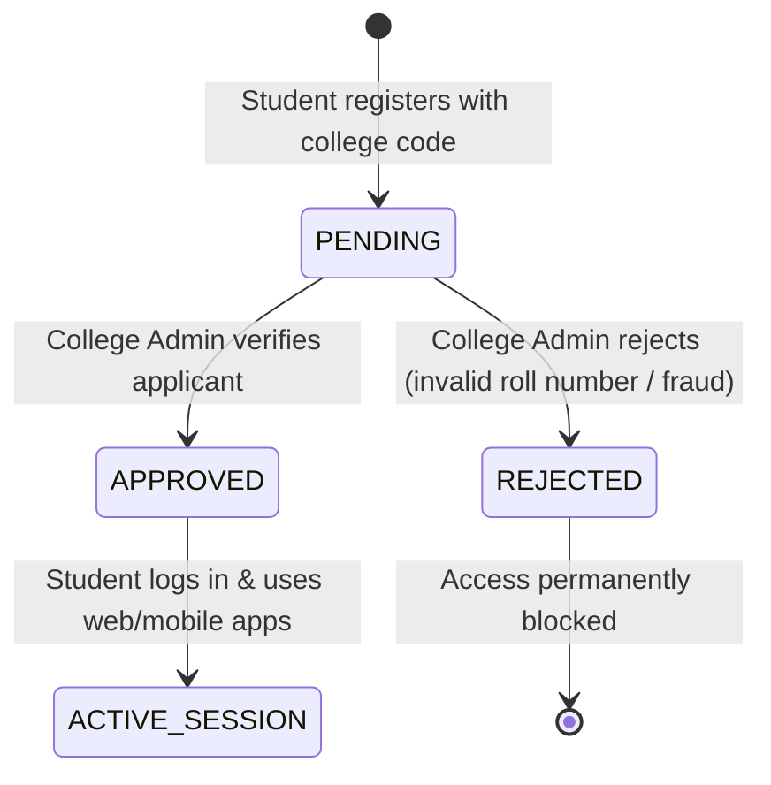

# Grievio System Architecture & Security Design

## 1. Multi-Tenant Architectural Pattern

Grievio is engineered as a shared-database, shared-schema multi-tenant platform with row-level logical separation. This approach allows high resource utilization across colleges while preserving strict boundaries between institutions.

### Data Isolation Principles
1. **Tenant Anchor**: The `Institution` model is the tenant anchor entity. Every college has a unique ID and college code (e.g., `MIT-ENG`).
2. **Discriminator Invariant**: Every institution-owned entity (`Department`, `CampusLocation`, `ComplaintCategory`, `Complaint`, `ComplaintAttachment`, `ComplaintComment`, `Notification`) has a properly enforced foreign key to `Institution`.
3. **ORM Scoping**: Every query in the Django REST Framework viewsets enforces `filter(institution=request.user.institution)` unless the user is a verified global `SUPERADMIN`.
4. **Backend Authorization**: Tenant context is derived exclusively from `request.user.institution`. Tenant IDs in incoming request payloads are never trusted.
5. **Student Privacy Protection**: A student user cannot query, read, or comment on any grievance where `student_id != request.user.id`.
6. **Department Staff Boundary**: Department technicians can only access tickets assigned to their department or explicitly assigned to their user ID.
7. **Administrative Separation**: College Administrators manage only their own college. Platform Super Administrators manage colleges globally.

---

## 2. Student Registration & Approval State Machine

To prevent unauthorized account creation, all student registrations follow an administrative verification gate:

- **Pending / Rejected Enforcement**: Server-side permission class `IsApprovedUser` blocks access to all grievance, department, and campus endpoints (`403 Forbidden`).
- **Administrative Endpoints**:
  - `GET /api/v1/accounts/pending-users/` - Lists pending registrations for the admin's institution.
  - `POST /api/v1/accounts/users/{id}/approve/` - Accepts `{action: 'approve'}` or `{action: 'reject', reason: '...'}`.

---

## 3. Client Platform Scope Matrix

| Role | Web Application | Mobile Application |
| :--- | :--- | :--- |
| **Student** | Full portal: raise complaints, upload photos, track timeline, comment, confirm/reopen. | Native app: camera upload, location selection, real-time push tracking, feedback. |
| **Department Staff** | Full portal: department queue, ticket status update, technician notes, proof upload. | Native app: on-site ticket queue, status updates, camera proof upload, direct notes. |
| **College Administrator** | Full console: approvals, staff provisioning, department SLAs, reassignments, analytics. | N/A (Administrators manage the college via the responsive web console). |
| **Platform Super Admin** | Full gateway: college approvals, tenant status, system health, platform telemetry. | N/A (Platform governance performed via the desktop web gateway). |

---

## 4. Role-Based Access Control (RBAC) Specification

| Permission Check | Student | Department Staff | College Admin | Super Admin |
| :--- | :---: | :---: | :---: | :---: |
| Register with College Code | Yes (Pending) | Yes (Pending) | Super Admin Setup | Initial Seed |
| Requires Admin Approval | Yes | Yes | No | No |
| Raise Grievance | Yes | No | No | No |
| View Own Grievances | Yes | Assigned Dept/Staff | All in College | All Platform |
| Update Status & Add Resolution Proof | No | Yes | Yes | Yes |
| Manage College Settings & Staff | No | No | Yes | Yes |
| Approve/Reject Student Registrations | No | No | Yes | View Only |
| Provision / Suspend Institutions | No | No | No | Yes |

---

## 5. Media & Storage Security

All attachments (evidence photos, proof of resolution) undergo:
1. Extension and MIME type validation.
2. Unique UUID file naming to prevent file path traversal.
3. Storage isolation path: `complaints/%Y/%m/` with ownership tracked by `uploaded_by` and `complaint.institution`.
